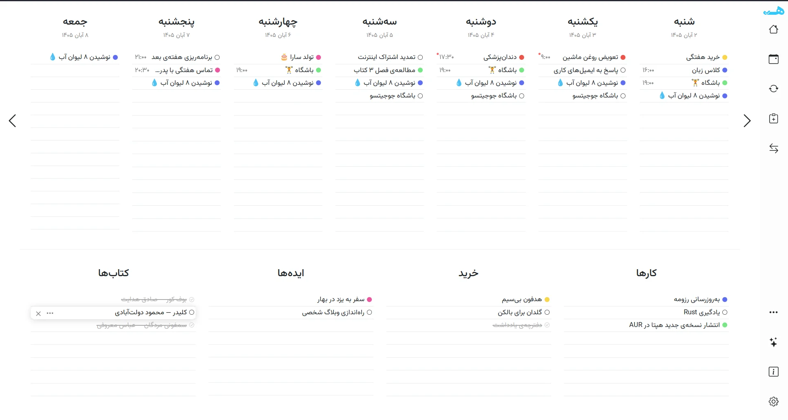

# Hapta | هَپتا

[](https://github.com/mohetios/hapta/actions/workflows/release.yml)
[](LICENSE)

**Hapta** is a minimalist, privacy-focused weekly planner for Persian speakers, built on top of [WeekToDo](https://github.com/manuelernestog/weektodo).
The goal: first-class **Jalali (Solar Hijri) calendar**, proper **RTL / Persian** UI, and a set of custom tweaks.

> The name comes from the Old Iranian root *haptá*, meaning "seven" (not "week" itself). It's a branding choice, not an attested word for "week".
>
> نام «هَپتا» برگرفته از ریشهٔ ایرانی باستانِ *haptá* به معنی «هفت» است، نه خود «هفته».



## Features

Inherited from WeekToDo:

- Cross platform (Linux, Windows, macOS, web)
- Light/dark mode
- Custom to-do lists
- Drag and drop
- Multi-language
- Sub-tasks
- Markdown support
- Customizable interface
- Local storage, no account needed
- Task colors and times
- Recurring tasks
- Notifications and reminders

## Status

Early stage. Right now the code is upstream WeekToDo with cleaned-up infrastructure (CI builds for Linux and Windows).
Persian / Jalali work starts once this baseline is stable.

## Roadmap

- [x] Fork + CI builds (Linux AppImage/deb, Windows installer)
- [ ] Clean-up and stable baseline
- [ ] Jalali calendar (week starts on Saturday, Persian month names, Jalali dates throughout)
- [ ] Full RTL layout and Persian fonts
- [ ] Persian digits and localisation
- [ ] Custom tweaks

## Download

Get Linux (AppImage, deb) and Windows (installer) builds from the [Releases](https://github.com/mohetios/hapta/releases) page:

- **Stable**: versioned releases (`v*`).
- **Nightly**: pre-release rebuilt on every push to `main`. Latest code, may be broken.

## Releasing

1. Bump `version` in `package.json` and commit.
2. Tag and push: `git tag v2.3.0 && git push origin v2.3.0`
3. CI builds Linux and Windows and publishes the release with generated notes.

## Build from source

Requires Node.js 16 and Yarn (webpack 4 doesn't work on Node 17+).

```bash
git clone https://github.com/mohetios/hapta
cd hapta
yarn install
yarn serve            # web version
yarn electron:serve   # desktop version
yarn electron:build   # package the desktop app
```

## Credits

Hapta is a fork of [WeekToDo](https://github.com/manuelernestog/weektodo) by [Manuel Ernesto Garcia](https://manuelernestogr.bio.link/) and its contributors.
If you'd like to support the original project: https://weektodo.me/support-us

## License

[GPL-3.0](LICENSE), same as upstream.
